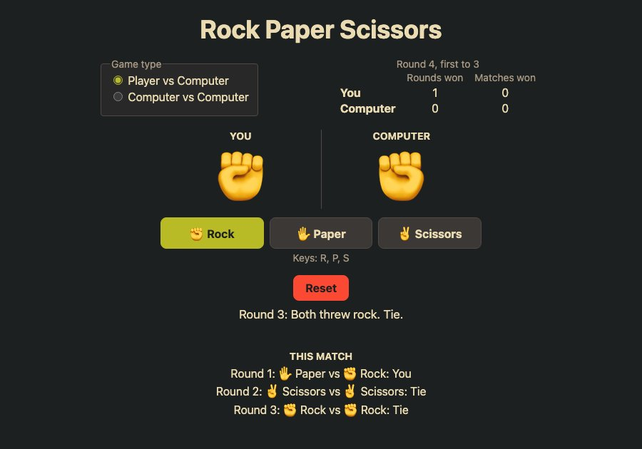

# Rock Paper Scissors

Play best-of-5 matches of Rock Paper Scissors against the computer, or watch two computers play each other. Click a weapon (or press R, P or S) to throw it; the first to three round wins takes the match, and ties don't count. The current match, its round history and the matches-won tally are kept between visits.

**Live:** https://namityadav.github.io/rock-paper-scissors/



## How it's built

- React 19 and TypeScript, built with Vite.
- All game rules (judging, ties, the end of a match, the tally) live in one pure reducer (`src/rules.ts`). The UI only dispatches actions, so the rules are tested without rendering anything. Round wins are derived from the history rather than stored, so the two can't disagree.
- A round is a short shuffle animation driven by an interval in the component, then a single `play` action that records the throw. Controls use `aria-disabled` rather than `disabled` mid-round, so keyboard focus stays where it was, and a second click can't play twice. With reduced motion preferred, the round settles at once.
- The verdict is announced in a live region and names both throws; when a match ends, focus moves to New match.
- The theme is Gruvbox, dark or light following the OS, with AA contrast.
- The mode, current match and tally go into `localStorage`, and every field is validated on load: malformed data falls back to a fresh game.
- Every push to `main` runs the linter, the tests and the build, and GitHub Actions deploys the result to GitHub Pages.

## Run it

```bash
npm install
npm run dev
npm run lint
npm test
```
